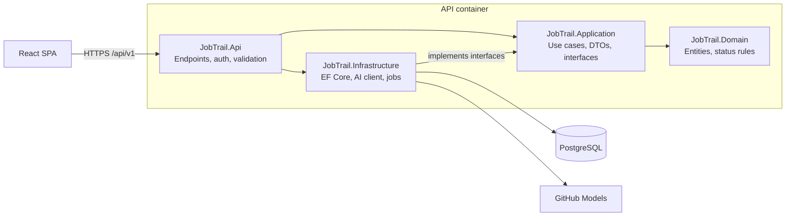

# JobTrail

> A job application tracker that helps you organize your job search and uses AI to compare your CV with job descriptions.


<!-- After the CI workflow exists, replace OWNER with your GitHub username: -->
<!--  -->

**Live demo:** _coming soon_ · **Demo login:** _coming soon_

---

## Why I built this

I'm a .NET developer looking for my first job in Prague. Instead of tracking applications in a spreadsheet, I built a tool for it — and used it to practise the skills employers ask for: ASP.NET Core, EF Core, PostgreSQL, clean architecture, testing, Docker, CI/CD and cloud deployment.

I use JobTrail for my own job search.

## Features

- 📋 **Application tracking** — companies, positions, job links, descriptions, salary range and notes
- 🗂️ **Board view** — drag applications between statuses (Wishlist → Applied → Interviews → Offer)
- 🕓 **Status history** — every change is recorded, with rules for valid transitions
- 🗓️ **Interviews** — date, type, notes and outcome for each round
- 🤖 **AI CV matching** — match score, matching skills and missing skills for any job ad
- ⏰ **Reminders** — follow-ups and interview prep, checked by a background service
- 📊 **Statistics** — applications per week, response rate by source, time to first interview
- 🔐 **Private accounts** — each user sees only their own data

## Screenshots

_Coming soon._

<!--


-->

## Tech stack

| Area | Technology |
| --- | --- |
| Backend | .NET (LTS), ASP.NET Core Web API, FluentValidation, OpenAPI/Swagger |
| Data | PostgreSQL, EF Core + Npgsql |
| Auth | ASP.NET Core Identity (cookie authentication) |
| AI | Microsoft.Extensions.AI + GitHub Models |
| Frontend | React, TypeScript, Vite, TanStack Query, React Router |
| Testing | xUnit, Testcontainers, WebApplicationFactory, Vitest |
| DevOps | Docker, Docker Compose, GitHub Actions, Railway |

## Architecture

JobTrail is a modular monolith using **Clean Architecture**. Dependencies point inward, so the Domain has no dependencies on EF Core, HTTP or AI code.



```text
JobTrail/
├── src/
│   ├── JobTrail.Api/             # Endpoints, auth, DI setup, middleware
│   ├── JobTrail.Application/     # Use cases, DTOs, validators, interfaces
│   ├── JobTrail.Domain/          # Entities, enums, status transition rules
│   └── JobTrail.Infrastructure/  # DbContext, migrations, AI client, background services
├── tests/
│   ├── JobTrail.UnitTests/
│   └── JobTrail.IntegrationTests/
├── web/                          # React + TypeScript frontend
├── docs/                         # Technical specification, screenshots
├── docker-compose.yml
└── .github/workflows/ci.yml
```

The full technical specification is in [`docs/`](docs/).

## Getting started

### Option 1: Docker (recommended)

Requirements: [Docker Desktop](https://www.docker.com/products/docker-desktop/)

```bash
git clone https://github.com/OWNER/JobTrail.git
cd JobTrail
docker compose up --build
```

Then open:

- Frontend: http://localhost:5173
- API docs (Swagger): http://localhost:8080/swagger

> The AI feature needs a GitHub Models token (see [Configuration](#configuration)). Everything else works without it.

### Option 2: Run locally for development

Requirements: .NET SDK (LTS), Node.js (LTS), Docker (for PostgreSQL)

```bash
# 1. Start only the database
docker compose up db -d

# 2. Set your AI token (stored outside the repo)
cd src/JobTrail.Api
dotnet user-secrets set "GitHubModels:Token" "<your-token>"

# 3. Run the API (migrations are applied on startup)
dotnet run

# 4. In another terminal, run the frontend
cd web
npm install
npm run dev
```

## Configuration

All settings come from environment variables (or user secrets locally). Nothing secret is stored in the repository.

| Variable | Description | Example |
| --- | --- | --- |
| `ConnectionStrings__Default` | PostgreSQL connection string | `Host=localhost;Database=jobtrail;Username=postgres;Password=…` |
| `GitHubModels__Token` | GitHub fine-grained token with **Models: read** | — |
| `GitHubModels__Model` | Model used for CV matching | `openai/gpt-4.1-mini` |
| `Cors__AllowedOrigins` | Frontend URL | `http://localhost:5173` |
| `Ai__DailyLimitPerUser` | Max AI analyses per user per day | `10` |

**Getting a GitHub Models token:** GitHub → Settings → Developer settings → Personal access tokens → Fine-grained tokens → create a token with the **Models: Read-only** permission.

## Running tests

```bash
# Backend: unit + integration tests (Docker must be running for Testcontainers)
dotnet test

# Frontend
cd web
npm test
```

Integration tests run against a real PostgreSQL database in a container. The AI provider is always replaced by a fake in automated tests, so tests are fast, free and reliable.

## Design decisions

| Decision | Why |
| --- | --- |
| **Clean Architecture, one deployable API** | Clear boundaries and testability without the overhead of microservices. |
| **No MediatR / CQRS** | Not needed at this size; services are called directly from endpoints to keep the code easy to follow. |
| **PostgreSQL** | Free, widely used, and JSONB is a good fit for storing AI results (skill lists). |
| **AI behind an `IAiMatcher` interface** | Free-tier terms and prices change often, so the provider can be swapped by configuration and mocked in tests. |
| **Caching AI results by input hash** | The same CV + job description is never sent twice, which saves quota and time. |
| **Cookie authentication** | The SPA and API share a domain, so HTTP-only cookies are simpler and safer than storing tokens in the browser. |
| **Testcontainers** | Integration tests use a real PostgreSQL instance instead of an in-memory fake, so they catch real database issues. |
| **Migrations on startup** | Simple for a portfolio app; a larger system would run migrations as a separate deployment step. |

## Privacy

CV text is sent to the AI provider only when you click **Analyze**. The public demo uses a sample CV. You can delete your account and all your data at any time.

## Roadmap

- [ ] **M1** Backend foundation — solution structure, PostgreSQL, CRUD
- [ ] **M2** Authentication, status workflow, CI pipeline
- [ ] **M3** React frontend MVP + first deployment
- [ ] **M4** AI CV matching
- [ ] **M5** Docker Compose, integration tests, reminders, statistics
- [ ] **M6** Logging, health checks, demo account, launch

**Ideas for later:** email reminders, importing job ads from a URL, AI-generated cover letter drafts, CSV export, Azure deployment.

## What I learned

_I'll keep notes here about the problems I ran into and how I solved them._

## Author

**Your Name** — .NET developer based in Prague

- LinkedIn: _add link_
- Email: _add email_

## License

This project is licensed under the MIT License — see [LICENSE](LICENSE).
