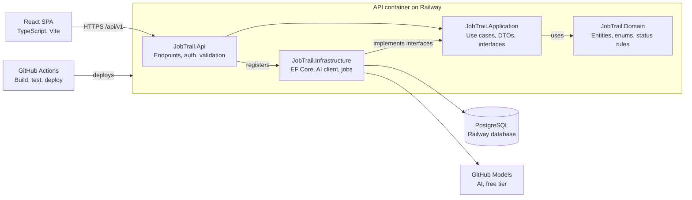
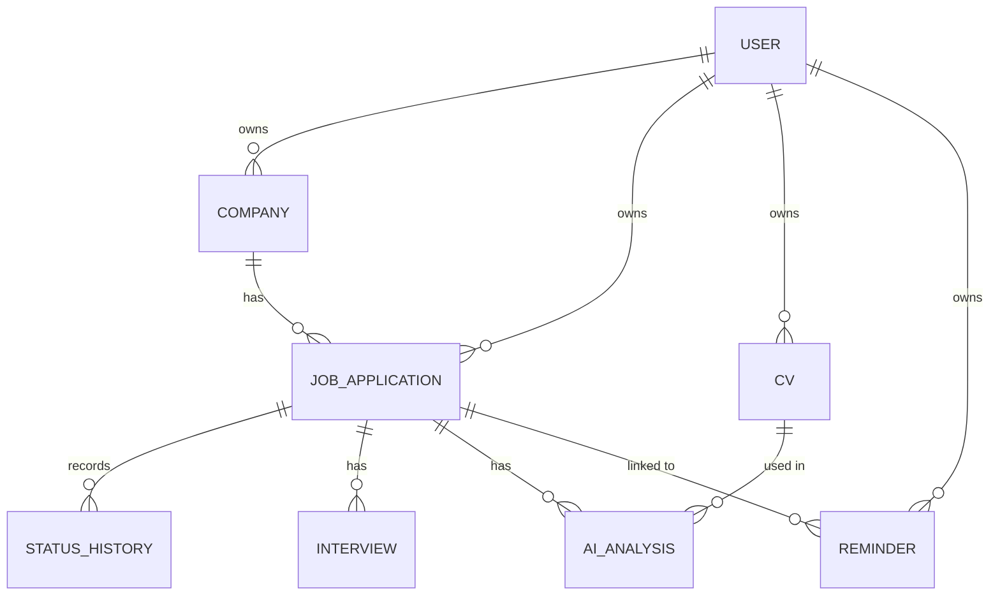
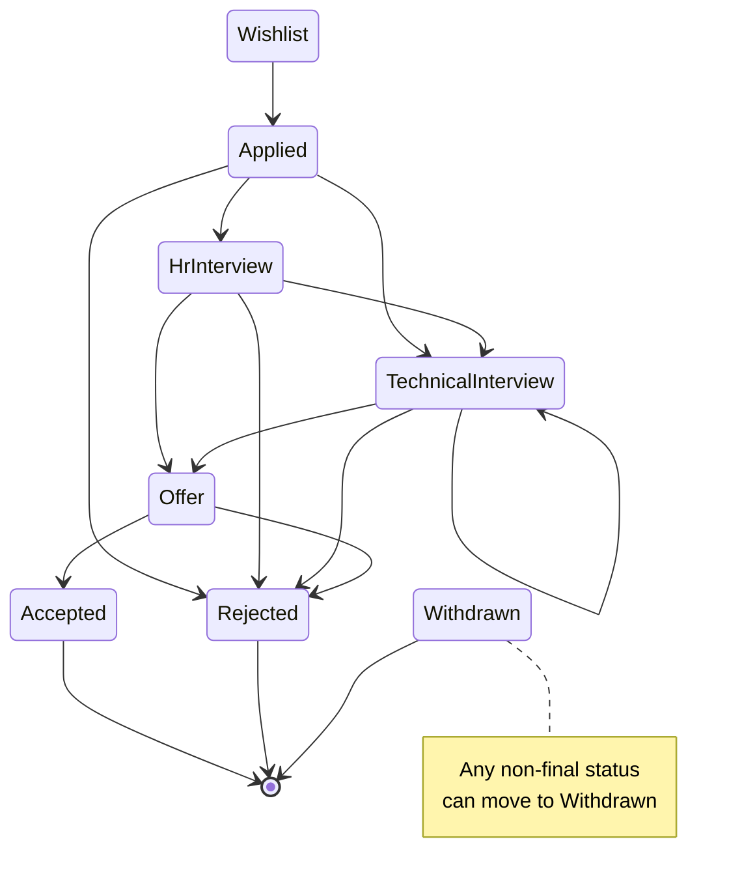

# JobTrail – Technical Specification

> [!info] Summary
> A job application tracker with AI CV matching, built as a .NET portfolio project.
> Stack: ASP.NET Core · PostgreSQL · React + TypeScript · Docker · GitHub Actions · Railway · GitHub Models

## Contents

- [[#1. Overview]]
- [[#2. Scope]]
- [[#3. Users and user stories]]
- [[#4. Functional requirements]]
- [[#5. Non-functional requirements]]
- [[#6. Architecture and tech stack]]
- [[#7. Data model]]
- [[#8. REST API specification]]
- [[#9. AI integration]]
- [[#10. Frontend]]
- [[#11. Security and privacy]]
- [[#12. Testing strategy]]
- [[#13. DevOps and deployment]]
- [[#14. Milestones and acceptance criteria]]

## 1. Overview

JobTrail is a web application that helps job seekers track their applications and uses AI to compare a CV with a job description. It is a portfolio project built to demonstrate the skills Prague employers look for in a .NET developer.

**Goals**

- Give one place to track every application, its status, interviews and reminders.
- Show how well a CV matches a job ad, and which skills are missing.
- Demonstrate production-quality .NET work: clean architecture, tests, Docker, CI/CD and cloud deployment.

**Target users:** job seekers, mainly junior and mid-level developers. The author is the first real user.

**Success criteria**

- The app is live on Railway with a public demo account.
- A stranger can run it locally with one command (`docker compose up`).
- CI is green, with unit and integration tests on every push.
- The author uses it for their own job search.

## 2. Scope

Version 1 covers tracking, CV matching with AI, reminders and statistics for a single user account. Anything not listed below is out of scope until after launch.

**In scope (v1)**

- User registration and login
- Companies and job applications (CRUD, filtering, search, paging)
- Status workflow with history
- Interviews and notes per application
- CV management (text format)
- AI match analysis of CV vs. job description
- In-app reminders
- Statistics dashboard
- Demo account with sample data

**Out of scope (v1)**

- Email or push notifications
- Importing job ads from a URL
- CV upload as PDF or Word file
- AI-generated cover letters
- Team or shared accounts, admin panel
- Mobile app

## 3. Users and user stories

There is one role in v1: a registered **User**, who sees and changes only their own data. Visitors without an account can only register, log in or use the demo account.

| ID | As a user, I want to… | So that… |
| --- | --- | --- |
| US-01 | register and log in | my data is private |
| US-02 | add an application with company, position, link and job description | I have everything in one place |
| US-03 | see my applications as a list and as a board by status | I know where each one stands |
| US-04 | change an application's status and see its history | I can follow its progress |
| US-05 | add interviews with date, type and notes | I can prepare and remember what happened |
| US-06 | save one or more CVs and set a default | I can analyze jobs against the right CV |
| US-07 | run an AI analysis of my CV against a job description | I see my match score and missing skills |
| US-08 | set reminders for follow-ups | I don't forget to reply or follow up |
| US-09 | see statistics about my search | I know which sources and approaches work |
| US-10 | try the app with a demo account | I can explore it without registering (recruiter view) |

## 4. Functional requirements

Requirements are grouped by module; each ID can be used as a GitHub issue.

### 4.1 Authentication

- **FR-AUTH-1** Register with email and password (min. 8 characters, at least one digit and one letter).
- **FR-AUTH-2** Log in and log out; the session uses a secure HTTP-only cookie.
- **FR-AUTH-3** Every query is filtered by the current user's ID. Accessing another user's resource returns 404.
- **FR-AUTH-4** A seeded demo account (`demo@jobtrail.app`) has sample data; its data is reset daily.

### 4.2 Companies

- **FR-COM-1** Create, read, update and delete companies (name required; website, location, notes optional).
- **FR-COM-2** Company names are unique per user (case-insensitive).
- **FR-COM-3** A company with applications cannot be deleted; the API returns 409 Conflict.

### 4.3 Job applications

- **FR-APP-1** Create, read, update and delete applications. Required: company, position. Optional: job URL, job description, source, salary range, applied date, notes.
- **FR-APP-2** List with filtering (status, source, company), full-text search (position, company), sorting (date, status) and paging (default 20, max 100).
- **FR-APP-3** Board view data: applications grouped by status.
- **FR-APP-4** Job description limited to 20,000 characters.

### 4.4 Status workflow

- **FR-STA-1** Statuses: Wishlist, Applied, HrInterview, TechnicalInterview, Offer, Accepted, Rejected, Withdrawn.
- **FR-STA-2** Allowed transitions are enforced in the domain (see [[#7.4 Allowed status transitions]]). Invalid transitions return 400 with a clear message.
- **FR-STA-3** Every status change creates a `StatusHistory` record with the old status, new status and timestamp.
- **FR-STA-4** Moving to Applied sets `AppliedAt` if it is empty.

### 4.5 Interviews

- **FR-INT-1** Add, edit and delete interviews per application: date and time, type (HR, Technical, Final, Other), notes, outcome (Pending, Passed, Failed).
- **FR-INT-2** Upcoming interviews are listed on the dashboard.

### 4.6 CVs

- **FR-CV-1** Create, edit and delete CVs as plain text (max. 15,000 characters), each with a title.
- **FR-CV-2** Exactly one CV can be the default; setting a new default unsets the old one.

### 4.7 AI analysis

- **FR-AI-1** The user can analyze an application against the default CV or a chosen CV.
- **FR-AI-2** The result contains a match score (0–100), matching skills, missing skills and a summary of max. 3 sentences.
- **FR-AI-3** Results are stored and shown on the application detail page, newest first.
- **FR-AI-4** If the same CV and job description were analyzed before, the stored result is returned without calling the AI.
- **FR-AI-5** Max. 10 analyses per user per day; above the limit the API returns 429.
- **FR-AI-6** If the AI provider is unavailable or rate-limited, the user sees a friendly message and can try again later.

### 4.8 Reminders

- **FR-REM-1** Create, edit, complete and delete reminders, optionally linked to an application.
- **FR-REM-2** A background service checks reminders every 15 minutes and marks due ones.
- **FR-REM-3** The dashboard shows overdue and today's reminders.

### 4.9 Statistics

- **FR-STAT-1** Count of applications per status.
- **FR-STAT-2** Applications per week (last 12 weeks).
- **FR-STAT-3** Response rate per source: share of applications that reached any interview status.
- **FR-STAT-4** Average number of days from Applied to the first interview.

## 5. Non-functional requirements

The app should feel fast for one user, stay free to run, and be easy for another developer to start.

| Area | Requirement |
| --- | --- |
| Performance | API responses under 300 ms (p95) for non-AI endpoints; AI analysis under 20 s, with a loading state in the UI |
| Availability | Best effort on Railway; `/health` endpoint for monitoring |
| Cost | 0 € beyond the existing Railway subscription; AI on the GitHub Models free tier |
| Security | OWASP basics: hashed passwords (Identity), HTTPS only, CORS limited to the frontend origin, no secrets in the repo |
| Privacy | Users can delete their account and all data; the demo uses a sample CV only |
| Usability | Responsive UI from 375 px (phone) to desktop; clear error messages |
| Maintainability | Clean Architecture layers; consistent code style (`.editorconfig`); nullable reference types enabled |
| Testability | Domain and application logic covered by unit tests; main flows covered by integration tests |
| Portability | Runs with `docker compose up`; configuration only through environment variables |
| Observability | Structured logs (Serilog) with request ID; errors returned as ProblemDetails |
| Documentation | README with setup, architecture, decisions; OpenAPI (Swagger) for the API |

## 6. Architecture and tech stack

JobTrail is a modular monolith using Clean Architecture: one deployable API with four layers, a React SPA, PostgreSQL and GitHub Models.



The API layer wires everything together; Infrastructure implements the interfaces defined in Application, so the Domain stays free of EF Core, HTTP and AI code.

### 6.1 Tech stack

| Area | Technology |
| --- | --- |
| Runtime | .NET (latest LTS), C# with nullable reference types |
| API | ASP.NET Core Web API, OpenAPI/Swagger, FluentValidation, ProblemDetails |
| Data | PostgreSQL, EF Core + Npgsql, code-first migrations |
| Auth | ASP.NET Core Identity, cookie authentication |
| AI | Microsoft.Extensions.AI, GitHub Models (OpenAI-compatible) |
| Background jobs | `BackgroundService` (hosted service) |
| Logging | Serilog, structured JSON logs |
| Frontend | React, TypeScript, Vite, TanStack Query, React Router |
| Testing | xUnit, Testcontainers, WebApplicationFactory, Vitest |
| DevOps | Docker, Docker Compose, GitHub Actions, Railway (optional Azure) |

### 6.2 Solution structure

```text
JobTrail/
├── src/
│   ├── JobTrail.Api/             # Endpoints, auth, DI setup, middleware
│   ├── JobTrail.Application/     # Use cases, DTOs, validators, interfaces (IAiMatcher, IAppDbContext)
│   ├── JobTrail.Domain/          # Entities, enums, status transition rules
│   └── JobTrail.Infrastructure/  # DbContext, migrations, AI client, background services
├── tests/
│   ├── JobTrail.UnitTests/
│   └── JobTrail.IntegrationTests/
├── web/                          # React + TypeScript app
├── docker-compose.yml
├── .github/workflows/ci.yml
└── README.md
```

> [!tip] Rules
> No MediatR, CQRS or microservices in v1; services in Application are called directly from endpoints. This keeps the code simple, and the README explains the trade-off.

## 7. Data model

PostgreSQL with EF Core (code-first migrations). All IDs are `uuid`, all timestamps are `timestamptz` in UTC, and every user-owned table has `UserId` with an index.

### 7.1 Tables

| Table | Columns | Notes |
| --- | --- | --- |
| Users (Identity) | Id, Email, PasswordHash, … | Managed by ASP.NET Core Identity |
| Companies | Id, UserId, Name (200), Website, Location, Notes, CreatedAt | Unique (UserId, lower(Name)) |
| JobApplications | Id, UserId, CompanyId, Position (200), JobUrl, JobDescription (text), Source, Status, SalaryMin, SalaryMax, Currency, AppliedAt, Notes, CreatedAt, UpdatedAt | Index on (UserId, Status) |
| StatusHistory | Id, JobApplicationId, FromStatus, ToStatus, ChangedAt | Insert-only |
| Interviews | Id, JobApplicationId, ScheduledAt, Type, Notes, Outcome | Cascade delete with application |
| Cvs | Id, UserId, Title, Content (text), IsDefault, ContentHash, CreatedAt, UpdatedAt | Partial unique index: one IsDefault = true per user |
| AiAnalyses | Id, JobApplicationId, CvId, InputHash, MatchScore, MatchingSkills (jsonb), MissingSkills (jsonb), Summary, Model, CreatedAt | InputHash = SHA-256 of CV + job description, used for caching |
| Reminders | Id, UserId, JobApplicationId (nullable), RemindAt, Message, IsDue, IsDone, CreatedAt | Index on (UserId, RemindAt) |

### 7.2 Relationships

- User 1 — N Companies, JobApplications, Cvs, Reminders
- Company 1 — N JobApplications (restrict delete)
- JobApplication 1 — N StatusHistory, Interviews, AiAnalyses, Reminders (cascade delete)
- Cv 1 — N AiAnalyses (set CvId to null on delete)



### 7.3 Enums (stored as strings)

- **ApplicationStatus:** Wishlist, Applied, HrInterview, TechnicalInterview, Offer, Accepted, Rejected, Withdrawn
- **ApplicationSource:** LinkedIn, JobsCz, StartupJobs, Referral, CompanyWebsite, Other
- **InterviewType:** Hr, Technical, Final, Other
- **InterviewOutcome:** Pending, Passed, Failed

### 7.4 Allowed status transitions

| From | Allowed next statuses |
| --- | --- |
| Wishlist | Applied, Withdrawn |
| Applied | HrInterview, TechnicalInterview, Rejected, Withdrawn |
| HrInterview | TechnicalInterview, Offer, Rejected, Withdrawn |
| TechnicalInterview | TechnicalInterview, Offer, Rejected, Withdrawn |
| Offer | Accepted, Rejected, Withdrawn |
| Accepted, Rejected, Withdrawn | None (final) |



## 8. REST API specification

All endpoints are under `/api/v1`, use JSON, require authentication unless marked public, and return errors as ProblemDetails (RFC 9457).

| Method | Endpoint | Description |
| --- | --- | --- |
| POST | /auth/register | Register (public) |
| POST | /auth/login | Log in, sets cookie (public) |
| POST | /auth/logout | Log out |
| GET | /auth/me | Current user |
| DELETE | /auth/me | Delete account and all data |
| GET | /companies | List companies |
| POST | /companies | Create company |
| GET / PUT / DELETE | /companies/{id} | Get, update, delete company |
| GET | /applications | List: `?status=&source=&companyId=&search=&sort=&page=&pageSize=` |
| GET | /applications/board | Applications grouped by status |
| POST | /applications | Create application |
| GET / PUT / DELETE | /applications/{id} | Get (with history and interviews), update, delete |
| PATCH | /applications/{id}/status | Change status: `{ "status": "HrInterview" }` |
| GET / POST | /applications/{id}/interviews | List, add interviews |
| PUT / DELETE | /interviews/{id} | Update, delete interview |
| GET / POST | /cvs | List, create CVs |
| PUT / DELETE | /cvs/{id} | Update, delete CV |
| POST | /cvs/{id}/default | Set as default |
| POST | /applications/{id}/analyze | Run AI analysis: `{ "cvId": "…" }` (optional, default CV if empty) |
| GET | /applications/{id}/analyses | List stored analyses |
| GET / POST | /reminders | List (`?due=true`), create reminders |
| PUT / DELETE | /reminders/{id} | Update, delete reminder |
| POST | /reminders/{id}/done | Mark as done |
| GET | /stats | Dashboard statistics |
| GET | /health | Health check (public, outside `/api/v1`) |

**Status codes:** 200 OK, 201 Created (with `Location` header), 204 No Content, 400 validation error, 401 not logged in, 404 not found or not owned, 409 conflict, 429 rate limit, 503 AI provider unavailable.

**Example: analyze response**

```json
{
  "id": "6f1c…",
  "matchScore": 72,
  "matchingSkills": ["C#", "ASP.NET Core", "PostgreSQL", "Docker"],
  "missingSkills": ["Azure", "Angular"],
  "summary": "Strong backend match. Missing cloud and frontend experience required by the role.",
  "model": "openai/gpt-4.1-mini",
  "cached": false,
  "createdAt": "2026-10-20T14:05:00Z"
}
```

## 9. AI integration

The AI analysis uses GitHub Models (free tier) through `Microsoft.Extensions.AI`, behind an `IAiMatcher` interface so the provider can be changed by configuration.

**Provider setup**

- Endpoint: `https://models.github.ai/inference` (OpenAI-compatible)
- Auth: GitHub fine-grained token with **Models: read** permission
- Default model: `openai/gpt-4.1-mini` (configurable via `GitHubModels:Model`)
- Packages: `Microsoft.Extensions.AI.OpenAI` (+ `OpenAI`)

**Flow of `POST /applications/{id}/analyze`**

1. Load the application and the chosen (or default) CV; return 400 if either text is missing.
2. Compute `InputHash` = SHA-256 of CV content + job description; return the stored analysis if one exists.
3. Check the daily limit (10 per user); return 429 if reached.
4. Trim inputs (CV max. 15,000, job description max. 20,000 characters).
5. Call `IChatClient.GetResponseAsync<CvMatchResult>()` with the prompt below and a 30 s timeout.
6. Validate the result: score 0–100, max. 30 skills per list, summary max. 500 characters.
7. Save to `AiAnalyses` and return 201.

**Prompt (system)**

```text
You are an experienced technical recruiter. Compare the candidate's CV with the job description.
Return: matchScore (0-100), matchingSkills (skills in both), missingSkills (required by the job, absent from the CV), summary (max 3 sentences).
Base the answer only on the given texts. Do not invent skills.
```

**Error handling**

| Situation | Behaviour |
| --- | --- |
| Provider returns 429 | Return 503 with "AI is busy, try again in a minute" |
| Timeout or network error | One retry after 2 s, then 503 |
| Invalid or unparsable response | Log the error, return 503; nothing is saved |
| Daily user limit reached | Return 429 with the reset time |

> [!note] Testing
> Tests never call the real provider. Unit and integration tests use a fake `IAiMatcher`; one optional manual test project calls the real API.

## 10. Frontend

A React + TypeScript single-page app (Vite), served from the same domain as the API so the auth cookie works without extra setup.

**Libraries:** React Router, TanStack Query (server state), React Hook Form + Zod (forms and validation), a UI kit (MUI, Mantine or shadcn/ui), Recharts (charts), dnd-kit (board drag and drop).

| Route | Page | Main content |
| --- | --- | --- |
| /login, /register | Auth | Forms; "Try demo" button |
| / | Dashboard | Counts per status, upcoming interviews, due reminders, charts |
| /applications | Applications list | Table with filters, search, paging; "New" button |
| /applications/board | Board | Columns per status; drag a card to change status |
| /applications/new, /applications/:id/edit | Application form | Company (select or create), position, link, description, source, salary |
| /applications/:id | Application detail | Info, status history timeline, interviews, AI analyses, "Analyze" button |
| /cvs | CVs | List, editor, set default |
| /reminders | Reminders | Overdue, today, upcoming; mark done |
| /settings | Settings | Account info, delete account |

**UI rules**

- Every list has loading, empty and error states.
- Invalid board moves are blocked in the UI using the same transition rules as the API.
- The AI result shows the score as a progress ring, with matching skills in green and missing skills in orange.
- API types are generated from the OpenAPI spec (e.g. `openapi-typescript`) so frontend and backend stay in sync.

## 11. Security and privacy

The main risks are one user seeing another user's data and leaking secrets; both are handled by design.

- **Data isolation:** every repository query filters by `UserId` (EF Core global query filter); integration tests check that user B gets 404 on user A's data.
- **Passwords:** ASP.NET Core Identity hashing; lockout after 5 failed logins for 5 minutes.
- **Cookies:** HTTP-only, Secure, SameSite=Lax; antiforgery protection on state-changing requests.
- **Rate limiting:** login (5/min per IP), AI analysis (10/day per user), general API (100/min per user).
- **Secrets:** user secrets locally, environment variables on Railway and in GitHub Actions; nothing in the repo or `appsettings.json`.
- **Input:** validation on every request (FluentValidation); length limits on all text fields.
- **CORS:** only the frontend origin.
- **Personal data:** CV text is sent to the AI provider only when the user clicks Analyze; the UI states this. The account delete endpoint removes all of a user's data.
- **Dependencies:** GitHub Dependabot enabled for NuGet, npm and GitHub Actions.

## 12. Testing strategy

Tests run on every push in CI; the build fails if any test fails. Target: at least 70% line coverage for the Domain and Application projects.

| Level | Tools | What is tested |
| --- | --- | --- |
| Unit | xUnit, FluentAssertions/Shouldly, NSubstitute | Status transition rules, validation, stats calculations, AI result validation, cache key logic |
| Integration | WebApplicationFactory, Testcontainers (PostgreSQL), Respawn | API endpoints end to end against a real database: auth, data isolation, CRUD, status change, analyze with fake AI, rate limits |
| Frontend | Vitest, React Testing Library | Forms, board move rules, key components |
| End to end (optional) | Playwright | Register → add application → change status → analyze |
| Manual | Swagger, browser | Real AI call, deployment smoke test |

**Rules**

- Tests are independent; the database is reset between integration tests (Respawn).
- The AI provider is always replaced by a fake in automated tests.
- Every bug fix adds a test that reproduces the bug first.

## 13. DevOps and deployment

Code goes to GitHub, GitHub Actions builds and tests it, and Railway deploys `main` only after the pipeline is green.

**Environments**

| Environment | Where | Database | AI |
| --- | --- | --- | --- |
| Local | Docker Compose | PostgreSQL container | GitHub Models (user secrets) or fake |
| CI | GitHub Actions | Testcontainers PostgreSQL | Fake |
| Production | Railway | Railway PostgreSQL | GitHub Models (env variable) |
| Optional | Azure Container Apps (free tier) | Railway PostgreSQL or Azure | GitHub Models |

**Configuration (environment variables)**

| Variable | Example |
| --- | --- |
| `ConnectionStrings__Default` | `Host=…;Database=jobtrail;Username=…;Password=…` |
| `GitHubModels__Token` | GitHub fine-grained token |
| `GitHubModels__Model` | `openai/gpt-4.1-mini` |
| `Cors__AllowedOrigins` | `https://jobtrail.up.railway.app` |
| `Ai__DailyLimitPerUser` | `10` |
| `ASPNETCORE_ENVIRONMENT` | `Production` |

**Docker**

- API: multi-stage Dockerfile (SDK image to build, ASP.NET runtime image to run), non-root user.
- Frontend: build with Node, serve static files with nginx (or from the API's `wwwroot`).
- `docker-compose.yml`: `db` (PostgreSQL with a volume), `api`, `web`.

**CI/CD pipeline (`.github/workflows/ci.yml`)**

1. Trigger on push and pull request to `main`.
2. Backend: `dotnet restore` → `dotnet build` → `dotnet test` (unit + integration with Testcontainers).
3. Frontend: `npm ci` → lint → `npm test` → `npm run build`.
4. Build Docker images to check they compile.
5. On `main` only, after all steps pass: Railway deploys the new version.

**Database migrations:** applied automatically at API startup in production (simple for a portfolio app; the README explains that a separate migration step would be used in a larger system).

**Branching:** one branch per feature, pull request into `main`, merge after CI passes; conventional commit messages (`feat:`, `fix:`, `test:`, `docs:`).

## 14. Milestones and acceptance criteria

The project is built in six one-week milestones; the MVP goes live at the end of week 3 and the portfolio version at the end of week 6.

| Milestone | Week | Delivers | Acceptance criteria |
| --- | --- | --- | --- |
| M1 Backend foundation | 1 | Solution structure, PostgreSQL, Companies and Applications CRUD, Swagger | FR-COM-1–3 and FR-APP-1–4 work in Swagger; data stored in PostgreSQL |
| M2 Auth and logic | 2 | Identity, data isolation, status workflow, interviews, CI | FR-AUTH-1–3, FR-STA-1–4, FR-INT-1; unit tests pass in GitHub Actions |
| M3 Frontend MVP | 3 | React app, list, board, forms, detail; first Railway deploy | US-01 to US-05 work in the live app |
| M4 AI feature | 4 | CVs, AI analysis, caching, rate limit | FR-CV-1–2 and FR-AI-1–6; a real job ad is analyzed in the live app |
| M5 Quality and DevOps | 5 | Dockerfiles, Compose, integration tests, reminders, stats | `docker compose up` starts everything; integration tests run in CI; FR-REM and FR-STAT done |
| M6 Launch | 6 | Logging, health check, demo account, README | Non-functional requirements met; README complete; demo login works |

**Milestone progress**

- [ ] M1 Backend foundation
- [ ] M2 Auth and logic
- [ ] M3 Frontend MVP
- [ ] M4 AI feature
- [ ] M5 Quality and DevOps
- [ ] M6 Launch

**Definition of done (every task)**

- [ ] Code merged into `main` through a pull request
- [ ] CI green
- [ ] Tests added for new logic
- [ ] No secrets or debug code committed
- [ ] README or API docs updated if behaviour changed

> [!question] Open questions
> - Which UI kit to use (MUI, Mantine or shadcn/ui)?
> - Serve the frontend from nginx or from the API's `wwwroot`?
> - Add the optional Azure deployment before or after launch?
